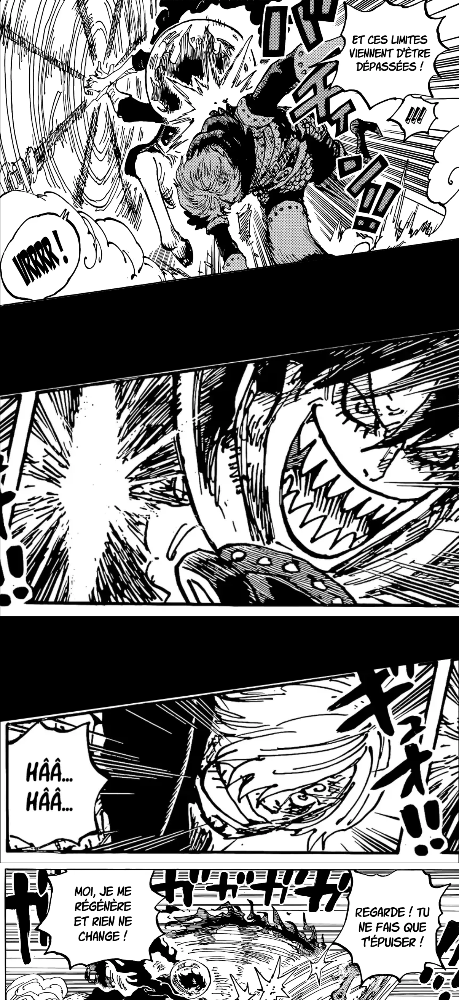

# MangaFlow

Prototype iPhone / iPad **iOS 27+** : importer un CBZ, détecter les cases sur l'appareil et lire le manga dans un défilement vertical. Aucun serveur, compte ni clé API. Le détecteur est inclus dans l'application.

## Avant → après

Une page de manga devient une suite de cases à lire en faisant défiler l’écran. La détection, l’ordre des cases et le rendu sont calculés sur l’iPhone.

<table>
  <tr><th>Avant · page source</th><th>Après · début de lecture</th><th>Après · en faisant défiler</th></tr>
  <tr>
    <td width="34%" valign="top"></td>
    <td width="33%" valign="top"></td>
    <td width="33%" valign="top"></td>
  </tr>
</table>

Exemple sur **ONE PIECE — Eiichiro Oda**, à partir d’une seule page du fichier de test `Chapitre 1196.cbz`. Les deux images de droite sont des **captures réelles de l’application dans le simulateur iOS**, après conversion de cette même page par le modèle embarqué. Elles montrent deux positions dans la lecture, sans retouche du résultat. Les bordures inclinées illustrent aussi le masquage des fragments de cases voisines.

La page et ses adaptations visuelles restent la propriété de leurs ayants droit et ne sont pas couvertes par la licence AGPL du code. Le CBZ complet n’est pas publié. [Source, crédits et reproduction des captures](Docs/demo/README.md).

## Lire sans distraction

- Importer un `.cbz` depuis Fichiers ou iCloud Drive ; la lecture s’ouvre après conversion.
- Faire défiler les cases, sans espacement ajouté ni compteur de pages.
- Toucher le bouton **œil** pour masquer les commandes ; **double toucher** sur une case pour les réafficher.
- **Simple toucher** sur une case pour ouvrir sa page originale et zoomer.

Aucun serveur, LLM distant ou téléchargement de modèle au premier lancement. Le TestFlight de développement est privé ; pour essayer le projet, compiler les sources ci-dessous.

## Essayer sur iPhone

1. Ouvrir `MangaFlow.xcodeproj` dans Xcode 27 ou plus récent.
2. Choisir la cible **MangaFlow**. Dans **Signing & Capabilities**, sélectionner son équipe Apple et, si nécessaire, changer le Bundle Identifier.
3. Connecter l'iPhone sous iOS 27, le choisir comme destination et lancer **Run**. Activer le mode développeur sur l'iPhone si Xcode le demande.
4. Dans l'app, toucher **Importer un manga** puis choisir le `.cbz` dans Fichiers / iCloud Drive.
5. La lecture s'ouvre à la fin de la conversion. Faire défiler ; toucher une case pour consulter et zoomer sa page originale.

Le CBZ de test complet n’est ni intégré à l’app ni versionné ; seule la page illustrant le README est publiée. Le modèle est déjà fourni : Python et l'export ne sont pas nécessaires pour lancer l'app. La première résolution de ZIPFoundation dans Xcode nécessite Internet ; ensuite l'app fonctionne hors ligne.

## Fonctions

- CBZ avec images JPEG, PNG et WebP ; tri naturel des fichiers, dossiers inclus.
- Conversion locale, une page à la fois, sauvegarde après chaque page.
- Pause / reprise, reprise après fermeture de l'app.
- Défilement vertical sans espacement ajouté entre les cases, ordre manga droite → gauche par défaut.
- Lecture immersive sans compteur : bouton œil pour masquer les commandes, double toucher sur une case pour les réafficher. Le simple toucher ouvre toujours l’original.
- Option gauche → droite dans le menu du lecteur.
- Consultation de la page originale avec zoom.
- Position mémorisée à la case près, réouverture et suppression des documents locaux.
- Couverture / page sans détection conservée entière.
- Contours inclinés : masquage transparent des fragments voisins quand une bordure fiable est trouvée ; les zones de texte détectées sont préservées.

Les documents déjà convertis sont mis à jour au prochain appui sur **Lire / Continuer**, sans réimporter le CBZ. Le menu du lecteur propose **Suivre les bords des cases** pour activer ou désactiver le masque.

La conversion doit rester au premier plan. Après suspension, revenir à la bibliothèque et reprendre si nécessaire. Ne pas compter sur une exécution prolongée en arrière-plan.

## Tests

```bash
xcodebuild -project MangaFlow.xcodeproj -scheme MangaFlow \
  -destination 'platform=iOS Simulator,name=MangaFlow-Test' \
  -derivedDataPath DerivedData CODE_SIGNING_ALLOWED=NO test
```

Les tests unitaires construisent leurs propres images et archives. Le test UI utilise un CBZ privé optionnel placé dans `/private/tmp/mangaflow-ui-fixture.cbz` ; en son absence il est explicitement ignoré. Pour le chapitre utilisé pendant le développement :

```bash
bash Scripts/test.sh '/chemin/vers/Chapitre 1196.cbz'
```

`MANGAFLOW_SIMULATOR` permet de préciser l'UDID du simulateur. Le script utilise par défaut celui créé pendant le développement ; sur un autre Mac utiliser la commande Xcode ci-dessus ou modifier cette variable.

## Organisation

- `Core/DocumentStore.swift` : import ZIP et persistance atomique.
- `Core/LocalPanelDetector.swift` : prétraitement 640×640, Core ML, retour aux coordonnées source.
- `Core/PanelLayout.swift` : dédoublonnage, ordre par séparations de mise en page, marges et préservation des zones de texte détectées.
- `Core/ContourRefiner.swift` : recherche locale des bordures obliques et construction des polygones, avec repli rectangulaire.
- `Core/ConversionEngine.swift` : orchestration et checkpoints.
- `Core/PageImage.swift` : décodage borné et cache mémoire des recadrages.
- `UI/` : bibliothèque, progression et lecteur.
- `project.yml` : source XcodeGen du projet (le projet généré est versionné).

## Modèle et limites

YOLO26n spécialisé manga, export Core ML FP32, environ 9,3 Mo. Ses rectangles sont affinés par une recherche géométrique des bordures inclinées. Les polygones masquent les pixels extérieurs sans redresser ni déformer le dessin. Une bordure trop ambiguë conserve le rectangle initial. Les bords ouverts, dessins qui débordent, bulles partagées et mises en page imbriquées peuvent encore donner des recadrages ou un ordre imparfaits. Les gouttières noires ne sont pas prises en charge par cet affinage : il recherche un trait sombre bordé d'une gouttière claire. Le traitement des doubles pages utilise les cases détectées et les séparations de mise en page ; il ne coupe pas systématiquement l'image en deux.

Pas d'éditeur manuel, OCR, traduction, CBR/PDF, export webtoon ni synchronisation. La position est conservée à la case près, sans décalage précis à l'intérieur d'une grande case. Les recadrages sont calculés à la demande et gardés en cache mémoire, sans copie disque supplémentaire.

Les mesures de validation et les limites observées sont dans `Docs/VALIDATION.md`.

## Reproduire l'export (facultatif)

Installer `Scripts/requirements-model.txt` dans un environnement Python 3.9 compatible, placer les poids officiels dans `/tmp/manga_panel_detector_fp32.pt`, puis exécuter `python Scripts/export_model.py`. Les coordonnées de sortie attendues sont `[1, 300, 6]` : x1, y1, x2, y2, score, classe.

Provenance et licences : voir `THIRD_PARTY_NOTICES.md`. Le code et le modèle exporté sont publiés sous **AGPL-3.0** ; voir [LICENSE](LICENSE). ZIPFoundation conserve sa licence MIT. Chika est une référence fonctionnelle ; l’application Swift est une implémentation indépendante.
